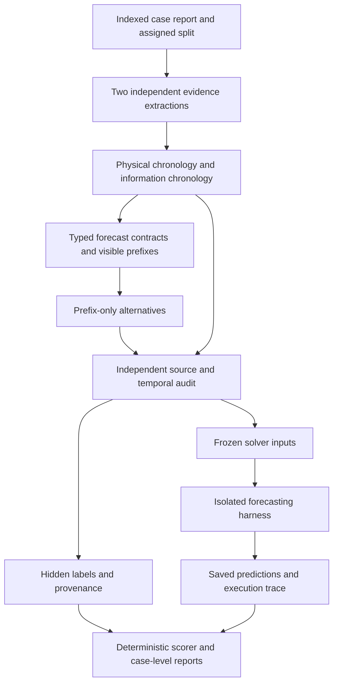
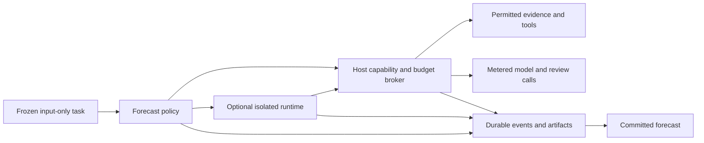

# Architecture for the clinical next-step benchmark and harness

Design baseline: 10 October 2026, D-19/D-20/D-21. Implementation pending. This document extends the direction already adopted in D-17/D-18; it does not describe new code as complete.

Clinical Orchestra turns supported portions of published case reports into forecasts about the next documented action, finding, assessment, clinical development, or treatment-associated response. A case may contribute several different tasks or none. The inference harness must handle all these targets without treating every question as a diagnosis problem.

The existing [construction pipeline](CONSTRUCTION_PIPELINE.md) supplies the starting implementation. The [broad harness review](HARNESS_LITERATURE_REVIEW_2026-10-04.md) and [focused forecasting review](NEXT_STEP_FORECASTING_LITERATURE.md) provide evidence and limitations. This design does not require training an EHR foundation model or creating a simulated patient.

The [science harness investigation](SCIENCE_HARNESS_INTELLIGENCE_2026-10-08.md) adds detailed Claude Science documentation, a pinned Prime Agent source inspection, and comparisons with Kosmos, PaperQA3 and scientific evaluation systems. D-20 makes programmatic execution, durable evidence and narrow review explicit interfaces. The one-action policy below remains the first enhanced control, rather than a limit on what the architecture can express.

The [general harness-engineering review](GENERAL_HARNESS_ENGINEERING_2026-10-10.md) compares controlled medical and general harness studies, simple-agent counterexamples, infrastructure effects and evaluation defects. D-21 requires a common, failure-complete measurement layer and matched development comparisons before promoting an enhancement. A policy that is more elaborate is not presumed more accurate.

The [prediction-target catalog](PREDICTION_TARGET_CATALOG_2026-10-10.md) inventories possible subtypes from case-report checklists and clinical data conventions. It is a discovery aid, not an expansion of the five adopted families. It identifies one possible gap: a fact that already existed physically but was only **discovered later** through history or examination may be neither progression nor the result of a known test. Count such candidates on development cases before considering a separate information-discovery family or a schema change.

## Task families

Retain the five event types from construction-v1. Introduce subtypes for reporting and eligibility, without creating a separate agent for each subtype.

| Family | Example forecast | Required boundary | Interpretation |
| --- | --- | --- | --- |
| Action | Which test or treatment did the team next document ordering or performing? | Next documented action within an explicitly stated category | Clinician behavior, conditioned on reported circumstances |
| Result | What finding was next reported for an already known test or procedure? | Named action must be known before the cutoff | New information; the underlying condition may already have existed |
| Diagnosis | What assessment or revision did the team next document? | Next documented assessment | Recorded belief or conclusion, not necessarily biological onset |
| Progression | What change or outcome was documented next or at a defined follow-up? | Next reported development or an eligible time window | Observed course, including deterioration, recovery, complications, or later status |
| Response | What change followed an already documented treatment? | Treatment known before cutoff plus eligible endpoint | Temporal association; a case report does not establish a causal treatment effect |

Action subtypes include tests, treatments, procedures, and care transitions. Progression subtypes include symptoms, complications, recovery, and outcome status. These are descriptive labels, not an ontology-based scoring vocabulary. The source must distinguish an order from a completed procedure; do not merge the two silently.

The primary target is the **next reported event under the declared contract**. We cannot infer every unreported event that actually occurred. Predicting best care, comparing unperformed interventions, continuous trajectory simulation, and free-text clinical judging remain separate possible future tracks.

## System layout

There are three separate responsibilities: construction creates and audits tasks; solving produces predictions without hidden data; scoring joins saved predictions to labels after solving. No solver call receives the article ending, constructor rationale, author thesis, or audit label.

## Shared case representation

Keep the linked chronologies already implemented. Each fact has a supported claim, source spans, event kind, physical-time description or interval, information-availability phase, and status. Facts may refer to known orders, pending tests, considered diagnoses, performed treatments, observations, or later corrections. Links connect a reported result to a known test and a reported response to a known treatment.

Preserve these distinctions:

- Physical occurrence versus the time it became available to the team.
- Source paragraph position versus clinical chronology.
- A clinician's suspicion versus an established finding.
- Unmentioned, unavailable, pending, explicitly absent, and explicitly normal.
- A correction learned later versus the information that was available earlier.

Represent ambiguous timing as an interval, partial order, or unresolved value. Do not invent precise timestamps. Simultaneous facts belong to one unordered information phase. A hidden physical chronology can support construction, but the visible input contains only temporal details supported as known by that cutoff.

Each source patient/article cluster stays in one split. Duplicate or related reports of the same case belong to that cluster where identified. Full-source records and construction artifacts live outside the solver's accessible files.

## Explicit forecast contracts

The current compiler derives questions from later facts, uses linked actions for results and responses, and stores endpoints as free text. The next contract version should make the following fields explicit and validate them before options are generated.

| Field | Purpose | Visibility |
| --- | --- | --- |
| `task_family`, `task_subtype`, `contract_version` | Declare the prediction being evaluated | Public |
| `cutoff` | Identify the compiled information boundary | Public in neutral form |
| `target_scope` | Distinguish next action, next test action, next assessment, next result, or next reported development | Public |
| `anchor` | Reference an already visible action or observation when required | Public; never name a future action |
| `endpoint` | Structured endpoint kind, reference event, duration/window, and units when applicable | Public |
| `endpoint_origin` | Protocol-defined, known schedule, or retrospectively selected report time | Audit metadata |
| `visible_evidence` | Permitted facts and local opaque evidence IDs | Public |
| `options` | Frozen mutually exclusive alternatives plus OTHER | Public |
| `source_support`, `target_fact_ids`, `answer_id` | Establish the observed label | Hidden |
| `observation_status` | Observed, explicit nonoccurrence through window, incomplete follow-up, or unknown | Hidden |
| `selection_metadata` | Mining rule, eligibility, cap selection, rejection history, constructor roles | Hidden/reporting |

The public item ID must not expose patient identity, article identity, diagnosis, or target text. Do not serialize the hidden half of this contract into prompts, tool payloads, error strings, or worker environment variables.

### Endpoint rules

Start with next-documented-event endpoints and a small set of predeclared temporal templates. A result question can name a test only if the input already discloses it. A response question can name a treatment only if it is already known.

For a fixed time window, its anchor must be visible and the duration must come from the protocol or a schedule known at the cutoff. The source must then support the outcome in that window. Do not choose a window because it surrounds a striking complication and present the question as if that window had been chosen prospectively.

An endpoint taken from retrospective reporting can still support an explicitly described exploratory task, but must carry that selection label and remain outside the prospective-window aggregate. For example, “the status at the next reported follow-up” is a valid documentation-conditioned endpoint; it does not imply a known seven-day biological outcome. “Immediately before the relapse” reveals the outcome and is invalid.

Do not use the nearest available observation as a measurement at the requested time unless the protocol defines a tolerance in advance. Exact date, duration, and numeric measurement tasks are deferred until units, intervals, and tolerances have their own contracts.

### Missing outcomes and simultaneous events

If the report stops before a requested window, mark the proposed item as unsupported or incompletely observed. Do not label it “no event.” Negative outcomes require explicit source support over the relevant interval; silence is insufficient. OTHER means an observed answer outside the alternatives, not missing follow-up, abstention, or uncertainty.

If several actions or findings have no supported internal order, use a source-supported bundle only when the alternatives can represent bundles consistently. Otherwise omit that proposed task and record why. Do not turn every pair of simultaneous facts into separate claims about which occurred first. Multi-label and set-valued scoring are deferred from the initial contract.

## Mining and auditing

Reuse the current sequence: index source, extract twice independently, compile candidate contracts, propose alternatives from prefixes, audit with the full source, export. No extra LLM is needed merely to route a task family; deterministic rules can inspect the extracted fact kinds and links.

Task miners enumerate eligible boundaries and produce an eligibility ledger. They do not promise one question per event. The author thesis may identify candidate regions during extraction, but remains hidden from the prefix, option writer, and solver. Important-to-the-author is a discovery signal, not evidence that an outcome was predictable.

The prefix-only option request receives the same question and evidence that the solver will see. It identifies structural defects and missing variables, then proposes plausible alternatives. It must not reject a question simply because several outcomes are plausible. That is ordinary forecasting uncertainty. Unsupported labels, overlapping options, unresolved chronology, and questions that reveal their answers are different defects and prevent export.

The independent source audit must check both entailment and opportunity for leakage: visible facts, anchor eligibility, endpoint wording and origin, target support, missing follow-up, and frozen-option mapping. Quote membership remains necessary but insufficient. Model agreement is not a clinical certificate.

In the next construction version, replace the early-first flat cap with a deterministic allocation across eligible families, using a fixed seed and declared rule. Allocate across families before taking additional items from a family; report available and selected counts. This avoids silently making early diagnostic workups the entire dataset. Do not force a family when the source lacks evidence. The existing construction-v1 cap and artifacts remain unchanged and separately versioned.

Capture whether an action was already announced in the input. Keep such examples, but report them separately from unannounced actions. Other descriptive strata include prefix length, number of information phases, known pending tests, explicit versus approximate timing, and missingness. None is automatically a validated measure of clinical difficulty. Model-disagreement subsets stay secondary and separately labelled.

## Forecasting harness

Use one orchestration engine with a task-family policy. It gets a compiled prefix, contract, frozen options, and a budget. Its job is to assign probabilities to the documented continuation, not to prescribe care or reconstruct the article.

The initial baseline makes one direct prediction. A separate strong control averages complete probability vectors from independent requests using a frozen rule; do not convert a majority vote into an unjustified near-certain probability. Keep temperature zero where supported, log exceptions, and distinguish repeat requests from option-order or prompt-variant ensembles. Higher-temperature experiments require a separately recorded protocol change.

The first enhanced policy uses this bounded sequence:

1. Record an initial forecast, concise evidence references, and unresolved uncertainties.
2. Select at most one allowed evidence action, or finish. Use a small configurable development limit rather than open-ended discussion.
3. Append the tool result without changing case facts or the original prediction.
4. Produce a separate final probability vector and a short record of which evidence informed any change.
5. Validate, save, and terminate under host-enforced limits.

Tools add evidence or flag problems; they never overwrite the baseline. The two forecasts remain distinct, so evaluation can identify improvements and regressions. A critic, recursive subcalls, additional loops, or editable notes is a named strategy variant with its own frozen configuration, not an invisible fallback.

Family policies direct attention rather than adding specialist personas:

| Family | Relevant context and tool use |
| --- | --- |
| Action | Current plans, unresolved questions, available resources when stated, practice setting, and constraints |
| Result | The already known test, specimen or timing when stated, prior findings, and relevant test interpretation |
| Progression | Baseline condition, recent trends, elapsed time, comorbidities and known interventions |
| Response | Known treatment, start time, prior state and documented exposure; do not infer an individual causal effect |
| Diagnosis | Evidence available to the team and previous assessments, with the same probability interface as other families |

Only family-relevant instructions differ. All strategies use the same information boundary and output schema. Probability calibration is assessed on held-out data; verbal confidence, rationale length, and inter-agent consensus are not substitutes.

### Tool and memory boundary

The initial tool set is read-permitted-evidence, validated arithmetic, narrow medical-reference retrieval, and finish. Arithmetic requires supported values and units. A missing input returns an explicit status. General literature is stored as external evidence and cannot become a patient observation.

Evidence reads return only the precompiled permitted facts or audited safe excerpts. A supporting paragraph may also contain a later outcome; its full text is not automatically safe to expose merely because one clause supports a visible fact. Do not provide a source-span lookup that bypasses the information cutoff.

Retrieval runs through a host broker with a frozen source policy. It excludes the originating report and identifiable copies, retaining the exclusion trace. Source dates and the use of current versus historical medical knowledge are declared in the run manifest. These controls reduce leakage risk without proving that the model has not memorized the case.

Create a fresh worker state for each cutoff. Schedule requests case by case for prefix-cache opportunities, but do not transfer generated notes or labels across items. Hypothetical future scenarios, if later tested, remain marked hypotheses and never become later-item inputs.

Use a restricted worker process for ordinary inference, and a stronger execution sandbox before enabling a REPL. Withheld data must be absent from accessible mounts; provider credentials and source exclusions stay in the host broker. A prompt asking the solver to ignore gold is not isolation. Validate tool capabilities and cumulative budgets outside generated code.

### Programmatic execution and durable evidence

D-20 separates the frozen task, a replaceable forecasting policy, a capability broker, an optional execution runtime, and a durable event/artifact store. The scorer is outside all solver-accessible components. Direct predictions need no runtime. Ordinary and programmatic tool calls use the same broker, so changing orchestration does not silently change evidence access.

Expose a small typed interface: list permitted capabilities, read permitted facts, retrieve a reference, compute from referenced inputs, read an artifact slice, save a hypothesis/note, and submit probabilities. These are proposed operations, not implemented methods. Return artifact IDs and bounded summaries for large results. Resolve IDs within the current item's namespace and authorize every read. An opaque ID is not authorization; guessed IDs and cross-item references must fail.

| Record | Required provenance | May the solver change it? |
| --- | --- | --- |
| Patient fact | Visible evidence ID and known-at boundary | No |
| External evidence | Query, source identity/date, captured response, exclusion-policy result | No; new retrieval creates another record |
| Calculation | Input record IDs, units, assumptions, executed operation and output | No; revision creates another record |
| Hypothesis or note | Supporting/conflicting record IDs and unresolved assumptions | Yes, retaining previous versions |
| Review finding | Reviewer/rule identity and inspected artifact versions | Append status changes; retain original |
| Forecast | Probabilities, evidence references, strategy version and submission status | No; initial and revised forecasts have distinct IDs |

External evidence does not acquire a patient known-at time merely by being retrieved. Derived records inherit restrictions from their inputs. Missing calculation inputs return an explicit status. A lineage record makes support inspectable; it cannot mechanically certify that a sentence entails a clinical interpretation.

Keep the actual operation stream outside the runtime. Log requests and results even when code never prints them. Include parent IDs, actual model identity, transport attempts, usage, truncation and errors. Do not infer completed work from code text or a retrospectively generated script. Compact notes can reference stored evidence, but rereads retain the same item and cutoff boundary.

### Bounded strategies and review

Add `bounded_programmatic` as a planned strategy alongside direct, repeated-request and one-action controls. It can compose permitted operations within frozen limits. Start without delegation; introduce child calls only as a separate experiment. Child contexts and permissions cannot exceed the parent scope. Block provider calls from generated code except through the broker.

Declare limits for model calls/tokens, tool operations, concurrency, runtime and artifact size, including initial predictions, retries, compaction, reviewers and descendants. Reserve capacity atomically before parallel dispatch; reconcile observed usage afterward and stop further dispatch at limits. Unknown usage remains unknown. Token reservations depend on provider reporting and output controls; they do not guarantee an exact invoice ceiling.

Record requested and actual model identity wherever the provider exposes them. Any model substitution must be declared in the strategy and reported as such; never silently attribute a fallback model's prediction to the requested model. This also applies to models embedded in retrieval tools.

Construction auditing sees the full source before freeze. Inference review sees only permitted evidence and checks supporting claims. Scoring alone joins forecasts to gold. Mechanical checks cover formats, IDs, arithmetic and access; an independent model's semantic flags remain fallible and separately reported. Review cannot establish clinical truth or claim to rerun an analysis without a logged execution.

A review-enabled strategy reviews an identified candidate version before submission, under a fixed schedule and maximum revision count. Reserve review capacity at run start. Timeout or exhausted capacity produces an explicit incomplete-review status under the frozen completion policy, never an invisible downgrade to unreviewed success. Post-submission findings cannot change the scored forecast. This boundary prevents asynchronous timing from selecting which version is scored.

### Recovery and fixed evaluation state

Persist responses and tool outputs before dependent work, with request IDs and content hashes. Recovery reuses a committed result instead of resampling. If a request may have reached a provider but its result was not saved, log the unknown outcome; any allowed retry is an additional attempt with possible additional cost. Mechanical replay and live re-execution are different modes.

Freeze environments and skills. Restart from the declared environment and supported structured artifacts; missing state is an explicit recovery failure. An agent may edit current-item hypotheses but cannot persist new skills, change policy, install unpinned dependencies, alter scoring, or communicate with other items. Infrastructure preflight catches unavailable tools before assignment; errors after assignment remain in the denominator.

Capabilities are predeclared for unattended runs. Product-style approval cards are not part of the benchmark protocol. Before real programmatic runs, test cutoff isolation, broker bypass attempts, nested budgets, capture of unprinted results, reviewer races and incomplete recovery.

## Evaluation and freezing

Freeze source versions, split assignments, accepted item IDs, task contracts, options, labels, prompts, strategy code, models, limits, retry rules, and retrieval policy. Construction cache and solver cache have separate namespaces. A strategy comparison must use identical frozen items; a constructor comparison uses identical source cases and reports its different exported item sets and reviewer roles.

For each valid probability vector, compute exact top-choice correctness, multiclass Brier score, and log loss against the frozen label. Define Brier as the unscaled sum of squared errors across options. Validate finite values, exact candidate-ID coverage, range, and sum within a preregistered rounding tolerance. Any permitted normalization must be logged. Report zero-probability gold predictions explicitly; if clipped log loss is also reported, publish the clipping constant and name it as clipped.

Also report operational accuracy over **every assigned item**, counting unsuccessful runs as incorrect, and the full completion/format/error counts. Proper probability scores apply to valid submitted distributions; display their denominator and completion rate together. Do not rank a failure-prone strategy as superior based on valid-only losses. A future composite failure penalty would be a separate declared operational metric, not an unqualified proper score.

Report each family separately. Within a family, average item scores inside each case cluster, then average across contributing clusters. Give the contributing case and item counts. A supplementary pooled aggregate may be reported with explicit fixed weights; changing family composition must not silently change the claim. Bootstrap paired differences by case/article cluster, retaining all related items and repeated requests together.

Track wrong-to-right and right-to-wrong changes from the initial forecast and probability-score changes even when the top answer stays the same. Include uniform-over-options as a deterministic reference; any learned prior must come from development data and cannot treat shuffled option letters as stable clinical classes. Calibration estimates for tiny families are exploratory. Selection into published reports prevents interpreting these probabilities as general population risks.

Every transport attempt, raw response, tool request, output, retry, failure, and observed usage is saved before derivation. Missing usage is unknown, not zero. A model failure may produce an explicit unsuccessful outcome without removing the item from the manifest; integrity failures such as manifest mismatch or leaked targets stop the run. Mechanical replay of saved outputs must reproduce scores.

D-21 adds an attempt state machine to make these rules testable: `assigned`, `request_prepared`, `dispatched`, `response_saved`, `parsed`, `submitted`, `scored`, or an explicit terminal failure. Save the actual rendered provider messages, tool schemas, executed tool arguments/results and content digests; prompt templates alone do not establish the worker's information state. A dispatched request whose result is not saved has an unknown provider outcome. A retry is a new recorded attempt with possible additional cost. Define one final submission channel; keep nonconforming answers in raw records and report them as submission failures in the primary analysis. Provider preflight happens before scored assignment. Report completion and failure classes beside valid-only probability scores and operational accuracy on all assigned items.

## Implementation map

Proposed modules below are not yet created.

| Component | Reuse | New responsibility |
| --- | --- | --- |
| Source and extraction | `construction/evidence.py`, `schemas.py`, extraction prompts | Versioned endpoint/observation metadata and family subtype support |
| Task compilation | `construction/compiler.py` | Explicit contracts, family allocation, endpoint eligibility and ambiguity ledger |
| Audit | Current independent source audit | Anchor/window/follow-up checks and complete typed-contract coverage |
| Frozen artifacts | Current separate input/output exports | Content hashes, schema versions and immutable evaluation manifest |
| Evaluation core | Existing model client, rate limits, peak guards and ledger | Strict prediction parsing, exact scoring, cluster aggregation and replay |
| Harness | Provider adapters and raw-response observers | Input-only worker, family policies, brokered tools, baseline preservation and budgets |
| Outer evaluation adapter | Inspect AI is the first integration candidate | Scheduling and standard logs without passing its target-bearing state to the worker |

Suggested new package boundaries are `forecasting/contracts.py`, `forecasting/miners.py`, `evaluation/predictions.py`, `evaluation/scoring.py`, `evaluation/reporting.py`, `harness/strategies.py`, `harness/tools.py`, and `harness/worker.py`. Keep the evaluation core callable without a framework; test an Inspect adapter before adding it as a required dependency. This limits migration risk to the existing Python 3.11 project.

D-20 adds proposed `harness/broker.py`, `harness/artifacts.py`, `harness/review.py`, and optional `harness/runtime.py`. Define interfaces and fake-tool fixtures first. Prime Agent's protocol is a runtime reference, not a dependency or replacement for the current client and ledger.

## Build sequence and acceptance criteria

**First, freeze contracts and fixtures.** Create clearly synthetic examples covering all five families, delayed disclosure of an earlier physical event, announced versus unannounced actions, simultaneous bundles, missing follow-up, and a known treatment without a reported response. Expected accept/reject reasons must be explicit. A future-named test and an outcome-named endpoint must fail.

Also include sentinel fixtures that prove the forbidden source location and attempted tool route were exercised before asserting no target leaked. This avoids a passing isolation test whose attempted delivery never occurred.

**Second, build the deterministic evaluation core.** Hand-computed probability examples, malformed outputs, zero probabilities, duplicate IDs, timeouts, identical-output replay, and case-weighted aggregation verify the metric and denominator rules. This work needs no credentials and does not establish clinical validity.

Build a durable direct-worker attempt journal next. Fake-provider tests cover response persistence before parsing, ambiguous timeouts, retries, invalid submissions, requested versus actual model identity, full assigned denominators and mechanical replay. The journal, strict scorer and worker boundary must function without an optional outer framework.

**Third, extend construction in a new version.** Add contracts and audits without rewriting old exports. Run the existing offline demo plus the new fixtures. Confirm no target, hidden timing detail, source title, or audit material appears in public exports. Retain all exclusion reasons and family counts.

**Fourth, run the small real development pilot when models are available.** Evaluate coverage, endpoint support, unsupported assumptions, OTHER frequency, and constructor/reviewer configuration. An empty family is evidence about the source material, not a reason to invent labels. Do not expand the corpus or choose harness prompts using the existing test-only cases.

**Fifth, compare direct and repeated-request baselines.** Then add structured notes, retrieval, and programmatic orchestration one at a time under declared budgets. Compare one-action and programmatic policies with the same capabilities and evidence access; report observed cost and latency as well as fixed limits. Add evidence review separately and delegation only for a concrete subtask. Verify isolation with sentinel hidden data and adversarial requests. Repeat promising comparisons across provider families; a stronger reviewer makes the result a mixed-model system, not the tested base model alone.

For each new mechanism, use the same scored cases, model, actual runtime, output contract and scorer as its control, and verify that the mechanism actually ran. Predeclare the main family/metric and a practical budget on development data. Report the number of policy variants tried, paired case-level uncertainty, completion and error rates; a matched repeated-request control accounts for extra inference. If an enhancement's benefit is unresolved or its completion regresses materially, keep it exploratory. Do not use untouched cases to select prompts or thresholds.

**Finally, freeze a confirmatory run.** Select policies on development data, declare metrics and budgets, and only then evaluate untouched cases. A sequential memory track, continuous trajectories, alternative interventions, or best-care recommendations require their own task contracts and validation.

## Current status

The existing implementation still has 52 previously passing offline tests and no live construction-quality estimate. That historical test result is not a test of this new architecture. No new schemas, prompt changes, solver, scorer, Inspect dependency, REPL, or paid model run were added while writing this design. Endpoint eligibility, family allocation, observation status, and the isolated evaluation worker are implementation work, not present guarantees.
